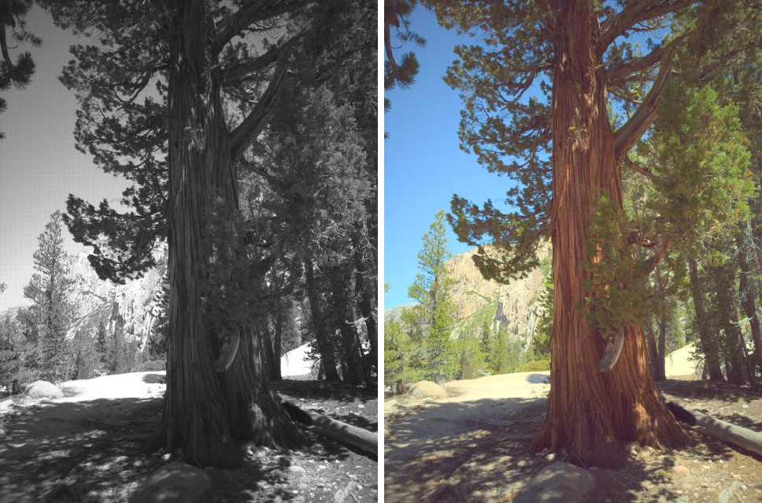
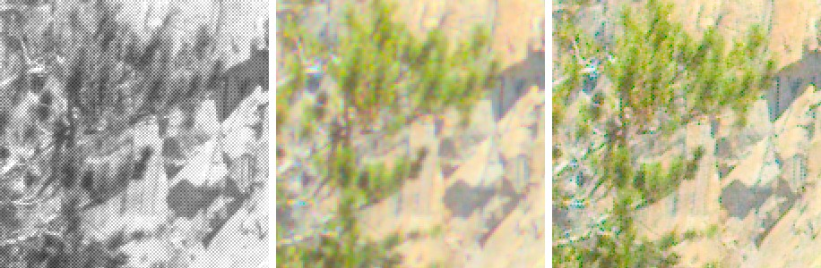
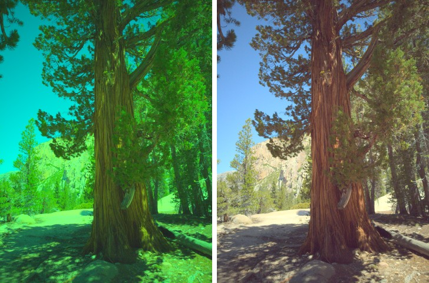
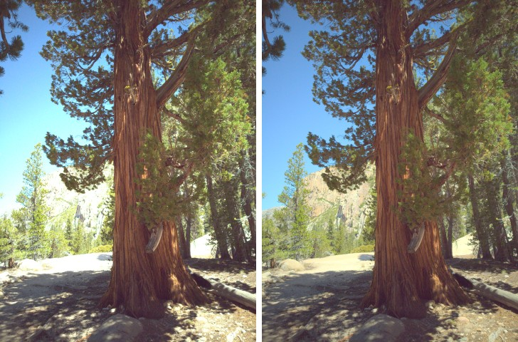
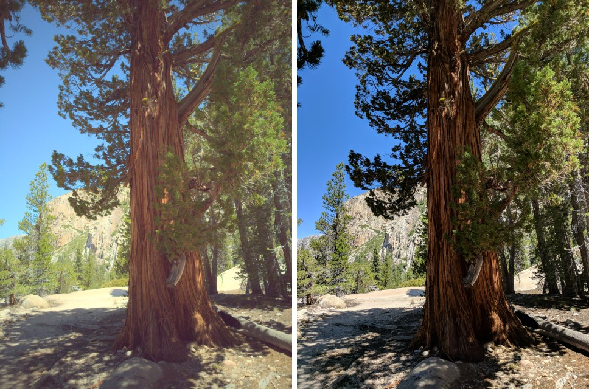

# minicam

A multi-threaded camera image signal processing (ISP) pipeline in modern C++, which turns RAW Bayer sensor data into finished RGB images.

minicam takes the raw output of a camera sensor and runs it through the stages a phone camera uses to produce a photo: black-level subtraction, demosaicing, white balance, color correction, tone mapping and denoising. The pipeline is designed like a simplified camera HAL. Each stage runs on its own thread, frames move through bounded queues, and frame memory comes from a reusable buffer pool, so several frames can be processed at once.

It is tested on real RAW bursts from the [Google HDR+ Burst Photography Dataset](https://hdrplusdata.org/), captured on Nexus and Pixel phones.



*Left: the black-level-corrected Bayer mosaic of one frame from the HDR+ dataset (burst `0006_20160722_115157_431`, frame 0), shown as grayscale: one color sample per pixel. Right: minicam's output with the default pipeline (Malvar demosaicing, gray-world AWB, the burst's `rgb2rgb.txt` color matrix, Reinhard tone mapping, bilateral denoising). Image from the HDR+ dataset, CC BY-SA 4.0.*

> **Status:** work in progress. Milestones 1–4 are done: all six ISP stages, a single-threaded and a thread-per-stage pipeline with bounded queues and a frame buffer pool, real DNG input from the HDR+ dataset via LibRaw, unit tests that pass under AddressSanitizer and ThreadSanitizer, and Kodak demosaicing results. Benchmarks, optimization and CI come next. See [Progress](#progress).

## Features

- **ISP stages implemented from scratch** (no OpenCV processing calls):
  - Black-level subtraction and normalization
  - Demosaicing: bilinear and Malvar-He-Cutler (2004)
  - Gray-world auto white balance
  - Color correction matrix
  - Gamma correction and tone mapping
  - Denoising (bilateral filter)
  - Optional HOG-based face detection
- **Camera-HAL-style system design**
  - Thread-per-stage pipeline connected by thread-safe bounded queues
  - Frame buffer pool, so no allocation per frame
  - Per-frame metadata (frame ID, timestamp, exposure, white balance gains)
  - Clean shutdown and error propagation
- **Inputs**
  - Real RAW/DNG files via LibRaw, tested on the Google HDR+ dataset
  - Synthetic RAW generated from any sRGB image, with known ground truth for testing
  - Stream mode for processing frame sequences and bursts
- **Engineering**
  - CMake build, GoogleTest unit tests, Google Benchmark performance tests
  - AddressSanitizer and ThreadSanitizer clean
  - GitHub Actions CI, clang-format, clang-tidy, Google C++ Style Guide

## Architecture

```
 ┌──────────────────────────── FramePool (N preallocated frames) ◄────────────────────────────────┐
 │ Acquire (blocks when all frames are in flight)                         handle destroyed → return │
 ▼                                                                                                  │
 source ─q0─► Black Level ─q1─► Demosaic ─q2─► White Balance ─q3─► CCM ─q4─► Tone Map ─q5─► Denoise ─q6─► sink
 thread        thread            thread         thread              thread    thread          thread        thread
 (read RAW,                                                                                       (write PNG)
  stamp id + time)

 q0..q6: BoundedQueue<FramePool::Handle>, capacity 2 by default.
 Each Frame carries its metadata (frame id, timestamp, exposure, black/white levels, CFA, WB gains, color matrix).
```

The single-threaded `Pipeline` runs the same `Stage` objects one after another on one frame. `ThreadedPipeline` runs them on the threads above. Both produce bit-identical output, and a unit test checks this.

**Design decisions**

- **Thread per stage:** it works like an assembly line. While the denoiser works on frame *n*, the tone mapper works on frame *n+1* and the demosaicer on frame *n+2*.
  - Throughput is limited by the *slowest* stage instead of the sum of all stages.
  - Frame order is preserved for free, because each stage is a single thread reading a FIFO queue. A thread pool, where any worker takes any frame, would need a reorder step at the end.
  - Each `Stage` object is only ever touched by one thread, so stages can keep scratch buffers without locks.
  - The trade-off: per-stage threads do not reduce the *latency* of a single frame, and a stage that dominates the run time (here the bilateral filter) caps the gain. Splitting one stage's image into tiles processed by several threads does reduce latency. The two approaches combine: tiling the slowest stage is planned in the Performance milestone.
- **Bounded queues:** each queue has a small fixed capacity (2 by default).
  - When a downstream stage is slow, its input queue fills, and `Push` blocks the stage before it. That pressure propagates back to the source, so the pipeline settles at the speed of its slowest stage instead of piling up frames, memory and latency (back-pressure).
  - Implemented as a monitor: one mutex, two condition variables (`not_full`, `not_empty`) waited on with predicates to handle spurious wake-ups, and a ring buffer allocated once.
  - `Close()` makes `Push` fail while `Pop` still drains the remaining items. That is what lets end-of-stream travel down the pipeline without losing frames.
- **Buffer pool:** a 12 MP frame holds about 216 MB of buffers (`uint16` RAW, float mosaic, float RGB). Allocating that per frame costs time and causes latency spikes: glibc maps and unmaps large blocks, and the kernel zeroes every new page on first touch.
  - `FramePool` allocates N frames once and lends them out as move-only RAII `Handle`s. A handle returns its frame to the pool when destroyed, so frames come back on every path, including errors and frames left in queues after an abort.
  - Buffers keep their capacity, so reused frames never reallocate. The free list is LIFO, so the most recently used (cache-warm) frame is reused first.
  - When all frames are in flight, `Acquire()` blocks, which caps memory, like `max_buffers` in an Android Camera HAL3 stream. The default N is the number of stages + 2.
- **Shutdown and errors:**
  - *End of stream:* the source closes `q0`, and each stage drains its input, closes its output and exits, so every frame is processed.
  - *Error:* the first error from the source, a stage or the sink is stored (labeled, e.g. `frame 5, stage 'fail_at': boom`). The pool and all queues are closed, so blocked threads wake up and exit, and `Run()` returns that error after joining every thread.
  - `Cancel()` takes the same path with a `CANCELLED` status.
  - Tests check that every frame is back in the pool afterwards and that nothing deadlocks.
- **Stage interface:** every stage implements `Stage::Process(Frame&)` and talks to other stages only through the `Frame` it is given. A `Frame` holds the metadata and one buffer per representation (`raw` uint16 mosaic, `bayer` normalized float mosaic, `rgb` linear float image). Because no stage knows about any other, a `Pipeline` is just an ordered `std::vector<std::unique_ptr<Stage>>`, and adding, removing or reordering stages only changes that list. The one rule is that a stage's input buffer must have been produced by an earlier stage; if it was not, the stage returns an error.
- **Stage order:** black level → demosaic → white balance → CCM → tone map → denoise.
  - The CCM is a change of color basis, so it runs on linear data, before the tone curve.
  - Denoising runs *after* tone mapping. Shot noise grows with brightness, and the sRGB curve roughly evens out the noise level (it acts like a variance-stabilizing transform), so one bilateral range sigma fits shadows and highlights alike. Production ISPs instead denoise RAW data early, using a calibrated per-ISO noise model.
  - White balance runs on demosaiced RGB. Many ISPs apply it to the mosaic before demosaicing, because Malvar's cross-channel correction assumes balanced channels. The stage interface makes that reordering easy to try.
- **Errors without exceptions:** following the Google C++ Style Guide, nothing throws. Stages return a `Status`, and the pipeline stops at the first failure and reports the frame id and stage name, for example `frame 7, stage 'demosaic_bilinear': expected a 1-channel Bayer mosaic`.

## Results

All images below come from one real frame of the HDR+ dataset (burst `0006_20160722_115157_431`, frame 0: 4048×3036, BGGR, 10-bit, 0.42 ms exposure). Each comparison changes one stage and turns bilateral denoising off, so only that stage differs. Images from the HDR+ dataset, CC BY-SA 4.0.

**Demosaicing.** Left to right: RAW mosaic, bilinear, Malvar-He-Cutler (crop of the cliff, enlarged 2× with nearest-neighbor).



Malvar recovers clearly sharper needles and rock edges. On this single, noisy phone frame it also turns sensor noise into colored speckle, because its Laplacian correction is a high-pass filter (the same effect that costs it 1.2 dB in smooth regions on synthetic data). This is one reason HDR+ merges a burst *before* demosaicing, and why ISPs denoise early.

**White balance.** Left: no white balance. Right: gray-world AWB.



Without white balance the image is strongly green-cyan, because the sensor's green channel is the most sensitive. Gray-world estimated R/B gains of 2.13/1.47; the camera's own as-shot gains in the DNG are 2.02/1.63.

**Tone mapping.** Left: auto exposure + clip + sRGB. Right: auto exposure + Reinhard + sRGB.



Clipping blows out the sunlit cliff and sand to flat white. Reinhard's curve rolls highlights off smoothly and keeps their detail, while leaving shadows and midtones almost unchanged.

**Comparison with Google's HDR+ result.** Left: minicam (one frame, default pipeline). Right: Google's `final.jpg` for the same burst (2017 HDR+ pipeline).



Colors and white balance match closely. The differences are expected from what minicam does not do yet:
- **Burst merging.** HDR+ aligns and merges the whole burst, which lowers noise.
- **Local tone mapping.** Google's result keeps darker, more contrasty shadows; minicam's global auto exposure lifts them.
- **Sharpening.** minicam does not sharpen.
- **Lens shading correction.** The DNG frames are darker in the corners (vignetting, visible in the RAW preview above). The burst includes per-frame lens shading maps, which minicam does not apply yet.

Two other observations from the three downloaded bursts:
- On a golden-hour burst, gray-world AWB removed the warm evening light, which was real, while the camera's as-shot gains (`--wb metadata`) kept it, like Google's result. This is the classic failure mode of the gray-world assumption.
- For burst `0006_20160727_200154_366`, Google's `final.jpg` shows a much narrower field of view than the DNG frames, although the DNGs have no crop tags; most likely the shot used digital zoom, which Google's pipeline applied. minicam renders the full sensor area.

**Demosaicing quality** on the Kodak set (24 images mosaicked through RGGB, compared with the originals; mean CPSNR, 10-pixel border excluded)

| Method | sRGB domain (dB) | Linear domain (dB) |
|---|---|---|
| Bilinear | 30.25 | 30.38 |
| Malvar-He-Cutler | **35.79** | **34.71** |
| Gain | +5.54 | +4.33 |

- **Sanity check.** In the sRGB domain (the usual literature protocol), Malvar gains 5.54 dB over bilinear, in line with the improvement of over 5.5 dB reported in the Malvar-He-Cutler paper. It wins on all 24 images in both domains.
- **Smaller gain in the linear domain** (hypothesis, not yet tested). The paper's correction gains were tuned on gamma-encoded images. In linear data, edges in bright regions produce much larger Laplacian values than the same edges in dark regions, so a fixed gain fits less well. Since minicam demosaics linear data, re-tuning the gains on linear data (or applying the correction in a gamma-encoded domain) is a measurable follow-up.
- **Hardest images:** kodim08 (fine shutters and brick texture, 29.20 dB) and kodim13 (detailed rocks and water, 29.56 dB). Their high-frequency detail is close to the Bayer sampling limit, where every linear demosaicer aliases.
- The per-image table is in [docs/results/kodak_demosaic.md](docs/results/kodak_demosaic.md). It is generated by `demosaic_eval` (see [Test and benchmark](#test-and-benchmark)). PSNR values are only comparable within a domain.

Measured so far on the procedural test scene used in the unit tests (256×192, 10-bit synthetic RAW, no noise, 2-pixel border excluded):

| Method | Full scene | Smooth region |
|---|---|---|
| Bilinear | 20.30 dB | 70.76 dB |
| Malvar-He-Cutler | 24.37 dB | 69.56 dB |

- The smooth-region scores are near the theoretical limit set by 10-bit quantization (about 70.4 dB for 959 levels), so both methods are effectively exact on smooth content.
- The full scene is dominated by aliasing on 3-pixel-wide stripes. That is where Malvar's cross-channel correction gains 4.06 dB.
- In the smooth region Malvar is 1.2 dB *worse*. Its Laplacian term is a high-pass filter, so it slightly amplifies quantization noise. This sharpness-versus-noise trade-off is why real ISPs denoise before or jointly with demosaicing.

**Denoising** (unit test, test scene in display values plus Gaussian noise σ = 0.03): the bilateral filter (σ_s = 2, σ_r = 0.08) raises PSNR from **30.42 dB to 41.31 dB**.

## Performance

Measured with Google Benchmark on _TODO: CPU, cores, RAM, OS, compiler_. Image size: _TODO_.

| Stage | Before optimization | After optimization | Change | Optimization |
|---|---|---|---|---|
| _TODO_ | _ms/frame_ | _ms/frame_ | _x faster_ | _e.g., cache-friendly layout_ |
| _TODO_ | _ms/frame_ | _ms/frame_ | _x faster_ | _e.g., tiled multithreading, SIMD_ |

| Pipeline | Throughput (FPS) | Latency p50 | Latency p99 |
|---|---|---|---|
| Single-threaded | _TODO_ | _TODO_ | _TODO_ |
| Multi-threaded | _TODO_ | _TODO_ | _TODO_ |

**Profiling notes:** _TODO: what perf showed and what you changed because of it._

## Getting started

### Requirements

- Linux, CMake 3.20+, a C++20 compiler (GCC 11+ or Clang 14+)
- LibRaw, OpenCV (I/O and display only), GoogleTest, Google Benchmark

On Ubuntu 22.04:

```bash
sudo apt install build-essential cmake ninja-build pkg-config libraw-dev libopencv-dev
```

GoogleTest (and later Google Benchmark) are downloaded at a pinned version by CMake, so local builds and CI use the same version.

### Build

```bash
git clone https://github.com/megamiii/minicam.git
cd minicam
cmake -B build -DCMAKE_BUILD_TYPE=Release
cmake --build build -j
```

### Get test data

The HDR+ dataset is large (the curated subset is 153 bursts, about 37 GiB), so it is not stored in this repository. `download_hdrplus.sh` fetches only a few bursts from `gs://hdrplusdata/20171106_subset` into `data/hdrplus/`: the payload DNGs, `rgb2rgb.txt`, the lens shading maps, and Google's `final.jpg` and `reference_frame.txt` (about 30–80 MB per burst).

```bash
./scripts/download_hdrplus.sh                 # the first 3 bursts (~158 MB)
./scripts/download_hdrplus.sh -n 5            # the first 5 bursts
./scripts/download_hdrplus.sh <burst name>    # specific bursts
./scripts/download_hdrplus.sh --list          # list all 153 burst names
```

It uses `gsutil` (Google Cloud SDK) as recommended by the dataset authors. The bucket allows anonymous reads, so if `gsutil` is not installed it falls back to plain HTTPS with `curl`.

To generate synthetic RAW from any image:

```bash
./build/make_synthetic_raw input.jpg data/synthetic.raw
# Optional: CFA pattern and sensor noise (variance = shot * signal + read^2)
./build/make_synthetic_raw input.jpg data/noisy.raw --cfa RGGB --shot-noise 0.002 --read-noise 0.01 --seed 1
```

The tool undoes the sRGB gamma, keeps one color per pixel in the chosen Bayer pattern, and stores 10-bit values with black level 64 and white level 1023 in a small `.raw` container that also holds the frame metadata.

### Run

`minicam` reads camera DNG files (via LibRaw) and minicam's own synthetic `.raw` files. For a single file it runs the single-threaded ISP and prints the time of each stage and the white balance gains it applied. If the input folder contains an HDR+ `rgb2rgb.txt`, that calibrated matrix replaces the DNG's own color matrix. Outputs are rotated upright according to the DNG Orientation tag.

```bash
# One frame of an HDR+ burst
./build/minicam --input data/hdrplus/<burst>/payload_N000.dng --output out.png

# Also save the RAW mosaic as a grayscale preview
./build/minicam --input data/hdrplus/<burst>/payload_N000.dng --output out.png --raw-preview raw.png

# Every stage can be selected or turned off, e.g. for before/after images
./build/minicam --input data/synthetic.raw --output out.png \
    --demosaic bilinear|malvar --wb gray-world|metadata|off --ccm on|off \
    --tone reinhard|clip --exposure 0.5 --denoise on|off \
    --sigma-spatial 2 --sigma-range 0.08
```

Stream mode processes every `.dng`/`.raw` file in a folder (for example a whole HDR+ burst) as one frame sequence. By default it uses the thread-per-stage pipeline; the source thread decodes the next DNG while the stage threads process earlier frames.

```bash
./build/minicam --input data/hdrplus/<burst>/ --output out/ --mode threaded     # or --mode sequential
```

Comparison images like the ones in [Results](#results) are made with `side_by_side`, which uses OpenCV only to crop, resize and join images for display:

```bash
./build/side_by_side out.jpg 480 out.png data/hdrplus/<burst>/results/final.jpg
./build/side_by_side --crop 0.15,0.55,0.05,0.0375 crop.jpg 300 raw.png bilinear.png malvar.png
```

### Test and benchmark

```bash
ctest --test-dir build --output-on-failure
./build/minicam_bench   # planned

# Sanitizer builds
cmake -B build-asan -DCMAKE_BUILD_TYPE=Debug -DMINICAM_SANITIZER=address && cmake --build build-asan -j
ctest --test-dir build-asan --output-on-failure
cmake -B build-tsan -DCMAKE_BUILD_TYPE=RelWithDebInfo -DMINICAM_SANITIZER=thread && cmake --build build-tsan -j
setarch "$(uname -m)" -R ctest --test-dir build-tsan --output-on-failure
```

`setarch -R` disables address-space randomization for the test process only. GCC 11's ThreadSanitizer runtime fails with `unexpected memory mapping` on recent kernels, which randomize more address bits than it expects.

# Demosaicing quality on the Kodak set (24 PNGs, ~15 MB, into data/kodak/)
./scripts/download_kodak.sh
./build/demosaic_eval data/kodak
```

`download_kodak.sh` currently fails because the host refuses non-browser downloads. In that case it prints instructions for saving the 24 images from [r0k.us/graphics/kodak](https://r0k.us/graphics/kodak/) by hand.

`demosaic_eval` samples each image through an RGGB mosaic with an ideal sensor (no noise or quantization), reconstructs it with both methods, and reports CPSNR (PSNR over all three channels) with a 10-pixel border excluded. It does this in two domains: directly on the 8-bit sRGB values, which is the usual protocol in the literature, and on linearized values, as in minicam's pipeline.

## Project structure

<!-- TODO: update as bench/ and CI are added -->

```
minicam/
├── include/minicam/      # Public headers: Status, Image, Frame, Stage, Pipeline, ThreadedPipeline,
│                         #   BoundedQueue, FramePool, CFA, color, metrics
│   ├── stages/           # Black level, demosaic, white balance, CCM, tone map, denoise
│   └── io/               # DNG reader, RAW container, synthetic RAW, image file I/O
├── src/
│   ├── core/             # Status, CFA, color transfer, PSNR
│   ├── stages/           # ISP stage implementations
│   ├── pipeline/         # Pipeline, ThreadedPipeline, FramePool
│   └── io/               # LibRaw DNG reader, .raw reader/writer, synthetic RAW, OpenCV file I/O
├── tools/                # minicam CLI, make_synthetic_raw, demosaic_eval, side_by_side
├── tests/                # GoogleTest unit tests and procedural test scenes
├── bench/                # (planned) Google Benchmark performance tests
├── scripts/              # Dataset downloads (HDR+, Kodak)
└── docs/                 # README images and generated result tables
```

`minicam_core` (stages, pipeline, synthetic RAW) has no OpenCV dependency. OpenCV is linked only into `minicam_io`, which decodes and encodes image files.

## Progress

- [x] **Milestone 1:** CMake skeleton, `Status`/`Image`/`Frame`/`Stage`, single-threaded `Pipeline`, black-level stage, bilinear demosaicing, synthetic RAW tool, PSNR metric, 43 unit tests (also clean under AddressSanitizer + UndefinedBehaviorSanitizer)
- [x] **Milestone 2:** Malvar-He-Cutler demosaicing, gray-world AWB, color correction matrix, auto exposure + Reinhard tone mapping + sRGB, bilateral denoising, full pipeline in the CLI with per-stage timing, `demosaic_eval` tool, 76 unit tests (also clean under ASan + UBSan)
  - [x] Kodak demosaicing results: Malvar +5.54 dB over bilinear (sRGB domain)
- [x] **Milestone 3:** camera-HAL-style system: `BoundedQueue` (back-pressure, close/drain), `FramePool` (RAII handles, bounded memory), `ThreadedPipeline` (thread per stage, ordered output, clean shutdown, first-error propagation, cancel), CLI stream mode; 101 unit tests, clean under ASan + UBSan and TSan (threading tests also repeated 50× under TSan)
- [x] **Milestone 4:** `download_hdrplus.sh` (gsutil, HTTPS fallback), LibRaw `DngReader` (CFA, per-tile black levels, white level, as-shot WB, color matrix, exposure, orientation), HDR+ `rgb2rgb.txt` sidecar matrices, DNG bursts in stream mode, upright output, before/after images and a comparison with Google's HDR+ result; 111 unit tests (DNG tests skip when the dataset is absent)
- [ ] **Milestone 5:** benchmarks, optimizations, profiling
- [ ] **Milestone 6:** CI, sanitizers in CI, clang-tidy, HOG face detection

## Roadmap

- [ ] Burst merging (align and merge several frames, in the spirit of HDR+)
- [ ] Lens shading correction (the HDR+ bursts include per-frame gain maps)
- [ ] Local tone mapping and sharpening
- [ ] SIMD versions of more stages
- [ ] Android version using the Camera2 `RAW_SENSOR` format

## References

- H. S. Malvar, L. He, R. Cutler. "High-quality linear interpolation for demosaicing of Bayer-patterned color images." ICASSP 2004.
- C. Tomasi, R. Manduchi. "Bilateral filtering for gray and color images." ICCV 1998.
- E. Reinhard, M. Stark, P. Shirley, J. Ferwerda. "Photographic tone reproduction for digital images." ACM Transactions on Graphics (SIGGRAPH), 2002.
- G. Buchsbaum. "A spatial processor model for object colour perception." Journal of the Franklin Institute, 1980 (gray-world assumption).
- N. Dalal, B. Triggs. "Histograms of Oriented Gradients for Human Detection." CVPR 2005.
- S. W. Hasinoff et al. "Burst photography for high dynamic range and low-light imaging on mobile cameras." ACM Transactions on Graphics (SIGGRAPH Asia), 2016.

## Data and license

Test images come from the [HDR+ Burst Photography Dataset](https://hdrplusdata.org/) by Google, released under [CC BY-SA 4.0](https://creativecommons.org/licenses/by-sa/4.0/). The images in `docs/images/` are derived from burst `0006_20160722_115157_431` of that dataset (processed by minicam, and Google's `final.jpg` for comparison) and are shared under the same license. If you use the dataset, cite:

```bibtex
@article{hasinoff2016burst,
  author  = {Samuel W. Hasinoff and Dillon Sharlet and Ryan Geiss and Andrew Adams and
             Jonathan T. Barron and Florian Kainz and Jiawen Chen and Marc Levoy},
  title   = {Burst photography for high dynamic range and low-light imaging on mobile cameras},
  journal = {ACM Transactions on Graphics (Proc. SIGGRAPH Asia)},
  volume  = {35},
  number  = {6},
  year    = {2016},
}
```

Demosaicing quality is measured on the [Kodak Lossless True Color Image Suite](https://r0k.us/graphics/kodak/) (PhotoCD PCD0992), which Eastman Kodak released for unrestricted use. These images are not stored in this repository either.

The minicam source code is released under the MIT License. See [LICENSE](LICENSE).
